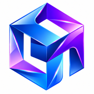

# CoreMind — Official Website & Project Platform

<p align="center">
  
</p>

<p align="center">
  <strong>Official marketing, technical documentation, and macOS distribution portal for CoreMind IDE.</strong><br />
  <em>Submitted to the Hackathon: Coding and Agentic Engineering Track (NVIDIA & Nebius AI Cloud).</em>
</p>

<p align="center">
  <a href="https://coremind.dev">Live Portal: coremind.dev</a> •
  <a href="#1-hackathon-overview--mission">Hackathon Mission</a> •
  <a href="#2-the-coremind-ecosystem">Ecosystem Architecture</a> •
  <a href="#3-website-setup--development">Website Setup</a> •
  <a href="#4-full-stack-ecosystem-setup-guide">Full-Stack Setup</a> •
  <a href="#5-ci--cd-pipelines">CI/CD Deployment</a>
</p>

---

## 1. Hackathon Overview & Mission

### Track
**Coding and Agentic Engineering Track**

### Problem Statement
Software developers spend up to 40% of their time deciphering unfamiliar codebases, writing repetitive boilerplate, context-switching between fragmented tools (chat windows, shell terminals, and file trees), and resolving regressions from unverified AI code suggestions.

Existing AI coding assistants fail because:
1. **Disconnected execution**: LLMs write code in a separate chat bubble without verifying whether it compiles or breaks tests.
2. **Missing dependency awareness**: Suggestions lack structural context regarding multi-file call hierarchies and project architecture.
3. **High cognitive friction**: Developers must manually copy, paste, run tests, diagnose stack traces, and feed errors back to the AI.

### The CoreMind Solution
**CoreMind** unifies coding, autonomous agent planning, and automated terminal verification into one native macOS desktop environment. It provides an autonomous software engineering loop:

$$\text{Task} \longrightarrow \text{Reasoning} \longrightarrow \text{Plan} \longrightarrow \text{Multi-File Diffs} \longrightarrow \text{Terminal Test Execution} \longrightarrow \text{Self-Healing Fixes} \longrightarrow \text{Verified Code}$$

This repository hosts the **production website, documentation reader, release distribution center, and interactive desktop product simulation** for the project.

---

## 2. The CoreMind Ecosystem

The CoreMind platform consists of three coordinated repositories:

```text
┌────────────────────────────────────────────────────────────────────────┐
│                        CoreMind IDE Ecosystem                          │
└──────────────────────────────────┬─────────────────────────────────────┘
                                   │
      ┌────────────────────────────┼────────────────────────────┐
      ▼                            ▼                            ▼
┌──────────────────┐      ┌──────────────────┐      ┌──────────────────┐
│ CoreMind-App     │      │ CoreMind-Backend │      │ CoreMind Website │
│ (Desktop IDE)    │      │ (Agent Engine)   │      │ (Web & Docs Hub) │
├──────────────────┤      ├──────────────────┤      ├──────────────────┤
│ • Electron 34    │      │ • FastAPI        │      │ • Vite 6 / React │
│ • Monaco Editor  │      │ • NVIDIA Nemotron│      │ • Tailwind CSS v4│
│ • xterm.js Shell │      │ • Nebius Cloud   │      │ • GitHub Pages   │
│ • Antigravity UI │      │ • Safe Patcher   │      │ • Live Simulator │
└──────────────────┘      └──────────────────┘      └──────────────────┘
```

1. **[CoreMind-Application](https://github.com/NVIDIA-CoreMind/CoreMind-Application)**: The native macOS Apple Silicon desktop IDE built with Electron, React, and Monaco Editor.
2. **[CoreMind-AI-Backend](https://github.com/NVIDIA-CoreMind/CoreMind-AI-Backend)**: The autonomous engineering agent engine powered by **NVIDIA Nemotron** via **Nebius Token Factory**, providing TaskGraph orchestration, AST symbol extraction, and self-healing test repair.
3. **[CoreMind](https://github.com/NVIDIA-CoreMind/CoreMind)** *(This Repository)*: The production-ready web platform deployed to [coremind.dev](https://coremind.dev), featuring technical documentation, changelogs, legal disclosures, and official `.dmg` downloads.

---

## 3. Website Setup & Development

### Prerequisites
- **Node.js**: v20 LTS or v22 LTS
- **Package Manager**: npm v9+

### Quickstart

```bash
# 1. Clone this repository
git clone https://github.com/NVIDIA-CoreMind/CoreMind.git
cd CoreMind

# 2. Install dependencies
npm install

# 3. Start local Vite development server
npm run dev
# Website opens at http://localhost:5173/
```

### Production Build & Verification

```bash
# Run oxlint code quality audit
npm run lint

# Run strict TypeScript compilation and Vite production build
npm run build

# Preview production build locally
npm run preview
```

---

## 4. Full-Stack Ecosystem Setup Guide (For Judges & Evaluators)

To run the complete CoreMind platform locally (IDE + AI Backend + Web Hub):

### Step 1: Start the CoreMind AI Backend

```bash
git clone https://github.com/NVIDIA-CoreMind/CoreMind-AI-Backend.git
cd CoreMind-AI-Backend

# Setup Python 3.11+ virtual environment
python3 -m venv .venv
source .venv/bin/activate
pip install -r requirements.txt

# Configure your Nebius Token Factory API key
cp .env.example .env
# Set NEBIUS_API_KEY in .env

# Run FastAPI backend
python3 main.py
# Server starts on http://127.0.0.1:8000
```

### Step 2: Launch the CoreMind Desktop Application

```bash
git clone https://github.com/NVIDIA-CoreMind/CoreMind-Application.git
cd CoreMind-Application

# Install dependencies and start Electron
npm install
npm run dev
```

### Step 3: Explore the Marketing & Documentation Portal

```bash
cd CoreMind
npm install
npm run dev
```

---

## 5. Website Architecture & Routes

| Route | Purpose | Key Features |
|---|---|---|
| `/` | Landing Platform | Hero, Interactive IDE Simulation, Features, 5-Phase Workflow, Screenshots, Team, Download |
| `/download` | macOS Release Hub | Native Apple Silicon `.dmg` installer, verified SHA-256 checksums, system specs |

### Official Release Artifacts (macOS Apple Silicon)
- **Installer**: `CoreMind-0.1.0-arm64.dmg` (162.1 MB)
- **Direct Link**: [Download CoreMind v0.1.0](https://github.com/NVIDIA-CoreMind/CoreMind-Application/releases/download/v0.1.0/CoreMind-0.1.0-arm64.dmg)
- **SHA-256 Checksum**:
  ```text
  232d3d9fc685b369a345c63bae472ce238cf5799e083bd7bda16db233ce49a5a
  ```
- **Terminal Verification**:
  ```bash
  shasum -a 256 CoreMind-0.1.0-arm64.dmg
  ```
| `/docs` | Technical Documentation | Quickstart guide, AI agent workflows, keyboard shortcuts, architecture overview |
| `/changelog` | Release History | Version highlights, feature breakdowns, and platform improvements |
| `/privacy` | Privacy Policy | Local workspace processing disclosures, external AI data handling rules |
| `/terms` | Terms of Service | Acceptable use policies, intellectual property rights, AI output verification |

---

## 6. Design & Performance Principles

- **Zero Clutter**: Clean, light interface (`#ffffff`) with subtle borders (`#e8e8e8`), high-contrast typography, and zero distracting gradients or AI boilerplate.
- **Accessibility**: Full `:focus-visible` indicators, semantic HTML elements, accessible navigation labels, and automatic `prefers-reduced-motion` compliance.
- **High Performance**:
  - Zero heavy animation libraries (optimized from 128 kB down to 4.8 kB).
  - WebP/PNG image compression and SVG vectors for all brand iconography.
  - Sub-200ms production builds with Vite and Tailwind CSS v4.

---

## 7. CI / CD Pipelines

This repository is configured with automated GitHub Actions workflows located in `.github/workflows/`:

1. **`ci.yml` (Continuous Integration)**:
   - Triggers on all Pull Requests and pushes to feature branches.
   - Executes `npm ci`, `oxlint` linting, and `tsc -b && vite build`.
2. **`cd.yml` (Continuous Deployment)**:
   - Triggers on pushes to `main`.
   - Automatically builds the production distribution and publishes to **GitHub Pages** with SPA routing (`404.html` fallback).

---

## 8. Team & Authors

- **Manoj Sarya** ([@Manojarya0207](https://github.com/Manojarya0207)) — Desktop IDE Architecture, Electron/React Core & Agent UI
- **Pankaj Sarya** ([@pankajsarya](https://github.com/pankajsarya)) — AI Agent Engine, NVIDIA Nemotron Integration & Tooling
- **Yashas** ([@yashas1624](https://github.com/yashas1624)) — Product Engineering, UI/UX, Testing & Workflows

---

## 9. License

This project is open-source under the [MIT License](LICENSE).
